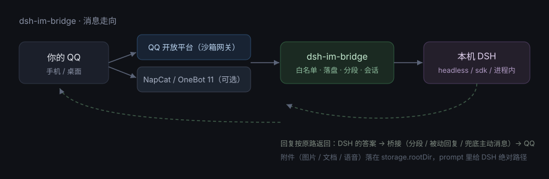

# dsh-im-bridge

**用 QQ 遥控你电脑上的 DSH**：发文字 / 图片 / 文档 / 语音，本机 DSH 干活，结果回到 QQ。不联网、不上云，电脑就是服务器。



[](https://github.com/1772538871/dsh-im-bridge/actions/workflows/ci.yml)


---

## 它能做什么 / 不能做什么

| ✅ 能 | ❌ 不能 |
| --- | --- |
| 你发一句话，本机 DSH 算完把答案发回 QQ | 机器人**不能主动**找你（平台限制，必须你先发） |
| 发图片 / 文档 / 语音 —— 落到本机目录，DSH 拿到**绝对路径**自己去读 | DSH 听不见语音（要配 `asr.command` 转写） |
| 多轮上下文（每个 QQ 会话绑定一个 DSH 会话） | 出站目前只有**文字**（DSH 生成的文件还不能发回 QQ） |
| 只允许白名单里的人驱动这台电脑；有并发闸和限流 | 想装软件、改系统文件这类高危操作默认被拒 |
| 支持两个平台：**QQ 官方机器人** / **NapCat（OneBot 11）** | 微信：栏目留着，但**未实现** |

---

## 两条路，选一条

| | 插件模式（推荐，会用的人 90% 选这个） | 命令行模式（开发者 / 不要 GUI） |
| --- | --- | --- |
| 是什么 | 装进 DSH，设置侧栏多一个「dsh bot」，点点就能用 | 纯 Node 进程，配置文件 + 命令行启动 |
| 适合 | 日常使用，想可视化配置 | 想在服务器/NAS 上跑，或接自己的进程管理 |
| 入口 | DSH → 设置 → **dsh bot** | `node bin/bridge.mjs` |
| 文档 | [docs/install.md · 插件](docs/install.md#方式一插件推荐) | [docs/install.md · 命令行](docs/install.md#方式二命令行) |

---

## 快速开始（插件，约 5 分钟）

```powershell
# 1) 取代码（HTTPS，不需要配 SSH key）
git clone https://github.com/1772538871/dsh-im-bridge.git
cd dsh-im-bridge

# 2) 装进 DSH 的 web profile
dsh plugin --profile web add .

# 3) 重启 DSH（插件组合只在启动时完成）
dsh web
```

4. 打开 DSH → **设置 → dsh bot**
5. 选平台 → 填参数 → **保存** → **启动**
   - **QQ 官方机器人**：填 AppID / AppSecret（开放平台后台拿），机器人需在「开发体验用户」里加上你自己的 QQ
   - **NapCat**：填 WebSocket 地址（默认 `ws://127.0.0.1:3001`）和 accessToken，详见 [docs/NAPCAT.md](docs/NAPCAT.md)
6. 用你的 QQ 给机器人发一句「你好」

> 需要：Node.js ≥ 20、DSH ≥ 0.2.1-rc.2、一个能用的机器人。装在别处遇到问题先看 [docs/troubleshooting.md](docs/troubleshooting.md)。

---

## 界面预览

设置页就是 DSH 设置侧栏里多出来的一页：

```
设置 → dsh bot
  平台      [ QQ 官方机器人 ▾ ]
  AppID     1029*****
  AppSecret ***            ← 只存本机，页面永远回显 ***
  白名单    你的 QQ 号（留空 = 拒绝启动）
  数据目录  E:\dsh-im-bridge-data
  [保存]  [启动]  [停止]   ← 状态行：运行中 · 平台 qq-official · 收到 12 / 已处理 11
```

> 截图（`docs/images/settings.png` / `docs/images/chat.png`）待补：见 [docs/images/README.md](docs/images/README.md)。

---

## 文档

| 想看什么 | 去哪 |
| --- | --- |
| **完全不懂技术**，只想按步骤点 | [docs/manual.zh.md](docs/manual.zh.md)（大白话手册） |
| 安装、平台接入、profile 准备 | [docs/install.md](docs/install.md) |
| 每一项配置是什么意思 | [docs/config.md](docs/config.md) |
| 不听话了怎么查 | [docs/troubleshooting.md](docs/troubleshooting.md) |
| NapCat 接入细节 | [docs/NAPCAT.md](docs/NAPCAT.md) |
| 安全边界（**建议先读**） | [docs/SECURITY.md](docs/SECURITY.md) |
| DSH 升级后怎么验证 / 提交规范 | [CONTRIBUTING.md](CONTRIBUTING.md) |
| 版本变更 | [CHANGELOG.md](CHANGELOG.md) |

---

## 兼容性与升级

- 已验证的 DSH 版本写在 `package.json` 的 `dsh.compatibility.dshReleases`；不在表里会在自检时告警。
- DSH 升级后跑一条命令，四条关键面（清单 / 设置页 bundle / 配置 / 版本）一次验完：

```powershell
node scripts/selfcheck.mjs
```

- 三个执行器可切换（`dsh.runner`）：`headless`（默认，最稳）/ `sdk`（常驻子进程，冷启动只付一次）/ `inprocess`（进程内，支持 QQ 审批，依赖 DSH 内部 API，升级可能碎）。碎了切回 `sdk`，聊天照常。

---

## 安全

这个插件等于给白名单里的人开放了本机的 DSH。**装完第一件事是填白名单**（留空会拒绝启动），并且：

- 机器人用小号；`AppSecret` 只存 `<DSH_HOME>/dsh-bot/config.json`，不会写进 profile 配置；
- 默认 `workspace-write`：DSH 只能改自己的工作目录；
- 完整威胁模型见 [docs/SECURITY.md](docs/SECURITY.md)。

## 许可证

MIT © 1772538871
